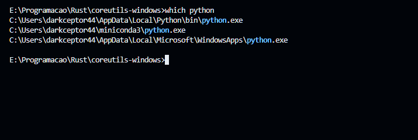

# which

A Rust implementation of `which` built for Windows first but cross-platform in theory.



## Installation

### CLI

```bash
cargo install --git https://github.com/DarkCeptor44/coreutils-windows which
```

Or grab a binary from [releases](https://github.com/DarkCeptor44/coreutils-windows/releases).

### Library

```bash
cargo add --git https://github.com/DarkCeptor44/coreutils-windows --no-default-features
```

Or:

```toml
[dependencies]
which = { version = "0.1.0", git = "https://github.com/DarkCeptor44/coreutils-windows", default-features = false }
```

## MSRV

The minimum supported Rust version is:

| Version | Edition | MSRV |
| --- | --- | --- |
| `<= 0.1.0` | 2024 | 1.85.0 |

## Usage Example

```rust
use which::which;

let found = which("python").unwrap();
// returns ["path/to/python.exe", "path/to/python3.exe"]
```

## Benchmarks

- **Machine:** Ryzen 7 3800X, RTX 2070 Super, 32GB DDR4 RAM

```text
Timer precision: 100 ns
which     fastest       │ slowest       │ median        │ mean          │ samples │ iters
╰─ which                │               │               │               │         │
   ├─ t=1  1.57 ms       │ 2.867 ms      │ 1.773 ms      │ 1.845 ms      │ 100     │ 100
   ├─ t=4  6.349 ms      │ 9.727 ms      │ 6.78 ms       │ 6.972 ms      │ 100     │ 100
   ├─ t=8  12.58 ms      │ 14.76 ms      │ 13.39 ms      │ 13.66 ms      │ 104     │ 104
   ╰─ t=16  25.26 ms      │ 29.35 ms      │ 27.14 ms      │ 27.47 ms      │ 112     │ 112
```

## Audits

Refer to [audits](../README.md#audits)

## License

This project is licensed under the [Mozilla Public License, version 2.0](https://www.mozilla.org/en-US/MPL/2.0/). See the [LICENSE](../LICENSE) file for details.
